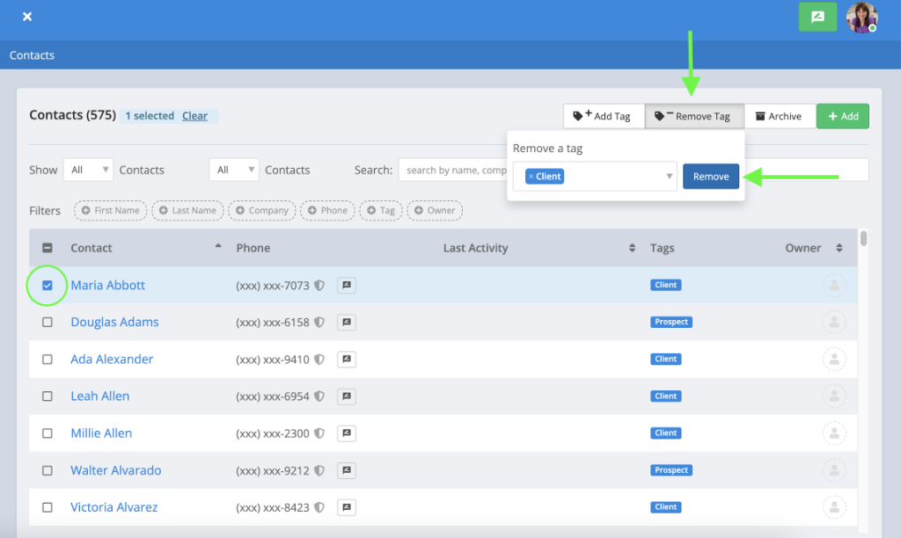

Tags are a flexible way to organize and group contacts in Captivated.

For example, you might use Tags to identify contacts by:

- Customer type
- Location
- Service
- Product interest
- Lead status
- Event or campaign
- Communication preference
- Other categories specific to your business

Tags can make it easier to find contacts and create targeted groups for [Announcements](/premium-features/announcements) 

## Add or Remove Tags

You can add or remove Tags from an individual contact or multiple contacts at once.

<Frame>
  
</Frame>

### Tag Multiple Contacts

From **Contacts**:

1. Select the contacts you'd like to update using the checkboxes next to their names.
2. Choose the option to **Add** or **Remove Tags**.
3. Select the appropriate Tag.
4. Apply your changes.

This is a quick way to organize several existing contacts without updating them individually.

### Tag an Individual Contact

You can also manage Tags from an individual contact record.

1. Open the contact.
2. Select **Edit**.
3. Locate the Tags field.
4. Add or remove the appropriate Tags.
5. Save your changes.

Tags can also be managed from the contact details within an active conversation.

<Note>
  Depending on where you're managing the contact, you may only be able to select existing Tags rather than create a new one.
</Note>

## Find Contacts Using Tags

Use **Advanced Tag Search** from your Contacts list to quickly find contacts associated with specific Tags.

When selecting multiple Tags, choose whether Captivated should **Match Any** or **Match All**.

| Search Option | What It Does |
| :-- | :-- |
| **Match Any** | Shows contacts who have at least one of the selected Tags. |
| **Match All** | Shows only contacts who have every selected Tag. |

### Example

Suppose you select:

**Lawn Treatment** + **Indianapolis**

**Match Any** would return contacts tagged with Lawn Treatment **or** Indianapolis.

**Match All** would return only contacts who have **both** Lawn Treatment **and** Indianapolis.

<Tip>
  Use **Match All** when you're trying to create a more specific audience from several different contact characteristics.
</Tip>

## Rename or Merge Tags

As your Tag library grows, you may need to rename outdated Tags or combine duplicate Tags to keep your contacts organized.

You can manage existing Tags from the **Contacts** section in Captivated.

### Rename a Tag

Renaming a Tag allows you to update its name without having to manually change the Tag on each contact.

To rename an existing Tag:

1. Navigate to **Contacts**.
2. Open the **Tag management** options.
3. Locate the Tag you'd like to rename.
4. Select the option to **Rename** or **Edit** the Tag.
5. Enter the new Tag name.
6. Save your changes.

The updated Tag name will be reflected on contacts associated with that Tag.

<Note>
  Renaming a Tag changes its name rather than creating a separate Tag. You do not need to manually update each contact.
</Note>

### Merge Tags

Merging Tags allows you to consolidate multiple Tags that represent the same category into one consistent Tag.

For example, your account might contain:

- `Current Customer`
- `Current Customers`
- `Existing Customer`

Instead of maintaining three separate Tags, you can merge them into one: **Current Customer**.

To merge Tags:

1. Navigate to **Contacts**.
2. Open the **Tag management** options.
3. Locate the Tag you'd like to merge.
4. Select the option to **Merge**.
5. Choose the Tag you'd like to merge it into.
6. Review your selections to make sure you're keeping the correct Tag.
7. Confirm the merge.

Contacts associated with the merged Tag will be organized under the remaining Tag.

<Warning>
  Review your Tag selections carefully before confirming a merge. Merging Tags consolidates the selected Tags, so make sure you've chosen the correct Tag to keep.
</Warning>

<Frame>
  
</Frame>

### When Should You Rename vs. Merge?

| Action | When to Use It |
| :-- | :-- |
| **Rename a Tag** | You want to correct a spelling mistake or update the name of an existing Tag. |
| **Merge Tags** | You have duplicate or similar Tags and want to combine them into one. |

<Tip>
  Before creating a new Tag, check whether a similar Tag already exists. Consistent naming helps prevent duplicate Tags and makes filtering and Announcement targeting easier.
</Tip>

#### Merging Tags Video Walkthrough

## Bulk Tag Contacts with a CSV Import

Administrators and users with Contact Import permissions can also add Tags to a large group of contacts using a [Contact Import](/features/importing-contacts).

Add a **Tag** column to your CSV and enter the Tag that should be associated with each contact.

During the import, map the column to the appropriate Tag field.

If you're updating contacts that already exist in Captivated, you'll have the option to determine how Tags should be handled.

| Option | What Happens |
| :-- | :-- |
| **Add to Existing Tags** | Keeps the contact's current Tags and adds the imported Tag(s). |
| **Replace Existing Tags** | Replaces the contact's existing Tags with the imported Tag(s). |

<Warning>
  Be careful when selecting **Replace Existing Tags**. Existing Tags may be removed from the contact record as part of the import.
</Warning>

See [Importing Contacts](/features/importing-contacts) for complete instructions.

## Using Tags for Announcements

Tags are especially helpful when you regularly communicate with specific groups of contacts.

For example, you could use Tags to create groups for:

- Customers at a particular location
- Customers receiving a particular service
- Event attendees
- Weather or service notifications
- Customers who have requested specific types of communications

When creating an [Announcements](/premium-features/announcements), Tags can help you quickly identify the appropriate recipients.

<Warning>
  A Tag helps organize your contacts—it does **not** by itself indicate that a contact has consented to receive marketing or promotional text messages. Always make sure you have the appropriate consent for the type of message you're sending.
</Warning>

## Tag Best Practices

- Use simple, descriptive Tag names.
- Establish consistent naming conventions across your organization.
- Avoid creating duplicate Tags with slightly different names.
- Periodically merge or rename outdated Tags.
- Use **Match All** to create more specific contact groups.
- Be cautious when replacing Tags during a Contact Import.
- Don't use Tags as your sole record of whether a contact has provided the appropriate messaging consent.

## Need Help?

If you need assistance organizing or managing your Tags, contact **Captivated Support** using the in-app **Support** option or text **(317) 316-3600**.
